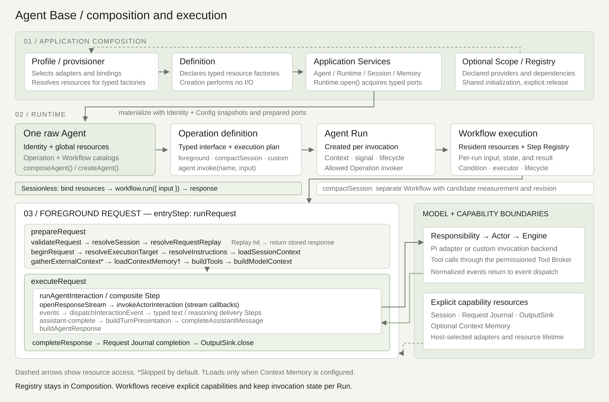

# Repository architecture

## Dependency direction

- Workflow is domain-neutral. Model Invocation owns model and Engine contracts independently
  of Agent Base and Workflow.
- Agent Memory uses Workflow and Model Invocation, without depending on Agent Base or a product.
- Agent Base composes its own packages with public Workflow, Model Invocation, and Agent Memory
  capabilities. It does not depend on Model Workbench.
- Model Workbench is independent of Agent Base and application runtimes. A consumer that uses both
  owns the integration between them.
- Reusable Agent UI packages depend on UI-owned contracts and external UI libraries. Agent Web
  composes Agent Base at its backend boundary; the component gallery exercises reusable UI alone.

Each module owns its packages, applications, tests, and adapters. The repository root contains
build tooling and architecture checks, not domain implementation. Products consume package exports
and supply their own integration and policy.

Agent Base Composition defines raw Agent assembly and managed application Services. Management,
Session navigation, and runtime Services acquire capabilities through typed Definition factories.
Profiles select adapters and may use the optional Resource Registry to share resources within a scope.
Workflow and Step implementations receive explicit resources and do not depend on this assembly.
Standalone Agent and Agent Web are reference compositions, not requirements for using the libraries.

## Agent Base execution

A Profile provisioner may use the Registry to resolve resources for Definition factories. Services
acquire ports through those factories. Workflows receive the capabilities they need as bound resources.

The session-aware foreground workflow returns the stored response on a replay hit. Otherwise it
prepares the model context, invokes the Actor, and completes the request. It can load Context Memory
when configured. Applications can add Retrieval Memory through their own tools or Steps.

Sessionless generation and interaction have separate workflows. The caller supplies the input and
binds resources, then calls `workflow.run({ input })` without creating an Agent or Session.

## Public boundaries

Cross-package imports use declared exports, never another package's source directory. Cross-module
relative imports are forbidden. Architecture tests and ESLint enforce the dependency direction.
Existing workspace package identities use the `@ta-agent/*` npm scope; Python distributions use
`ta-agent-*` and import modules use `ta_agent_*`.
